<div align="center">

<picture>
  <source media="(prefers-color-scheme: dark)" srcset="docs/assets/hero-dark.svg">
  
</picture>

<br/><br/>

<a href="#install"><picture><source media="(prefers-color-scheme: dark)" srcset="docs/assets/btn-install-dark.svg"></picture></a>
<a href="#the-app"><picture><source media="(prefers-color-scheme: dark)" srcset="docs/assets/btn-app-dark.svg"></picture></a>
<a href="#how-it-works"><picture><source media="(prefers-color-scheme: dark)" srcset="docs/assets/btn-how-dark.svg"></picture></a>
<a href="https://github.com/masterrr3470/keepcode/issues/new"><picture><source media="(prefers-color-scheme: dark)" srcset="docs/assets/btn-help-dark.svg"></picture></a>

<br/><br/>

<a href="https://github.com/masterrr3470/keepcode/actions/workflows/ci.yml"></a>


<a href="LICENSE"></a>

</div>

<br/>

## Why

I built keepcode after losing the code of a restaurant ordering app I was working on and having to rebuild it from scratch.

Code rarely gets lost in a dramatic way. It is a project that never left the Downloads folder, a repository with no remote, a week of work nobody committed. keepcode is an app that checks every project on your computer at once and backs up what is at risk to private GitHub repositories, without touching your files or your branches.

## The app

<picture>
  <source media="(prefers-color-scheme: dark)" srcset="docs/assets/app-dark.svg">
  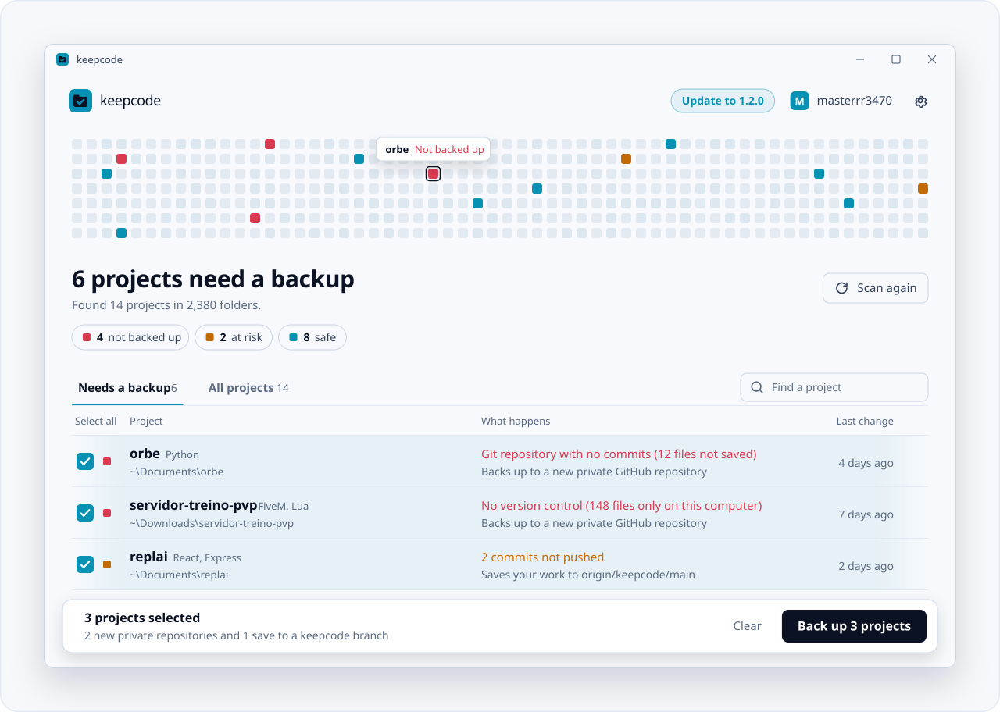
</picture>

Open keepcode and it starts looking straight away. A grid of squares lights up as it searches, one square per project, in the colour of how safe that project is. Then it lists the projects that need a backup, with the reason next to each one and the ones worth saving already selected. One button backs them all up.

Everything else lives in the same window: connecting to GitHub with a short code, updating keepcode, choosing which folders to search and turning on the daily check. Nothing to type.

<p align="center">
  <picture><source media="(prefers-color-scheme: dark)" srcset="docs/assets/feat-find-dark.svg">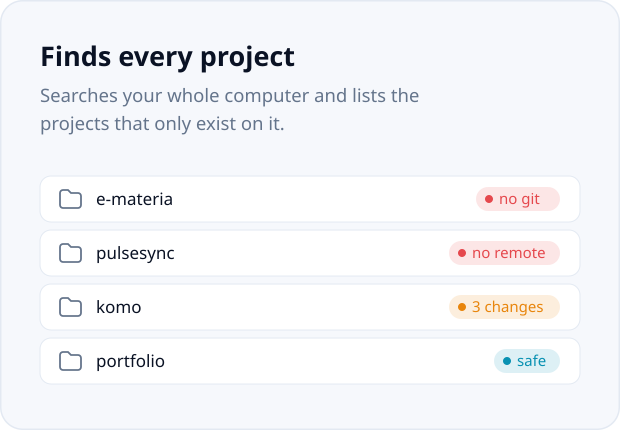</picture>
  <picture><source media="(prefers-color-scheme: dark)" srcset="docs/assets/feat-oneclick-dark.svg">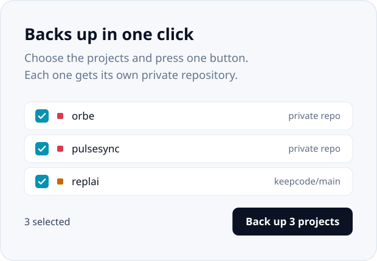</picture>
</p>
<p align="center">
  <picture><source media="(prefers-color-scheme: dark)" srcset="docs/assets/feat-safe-dark.svg">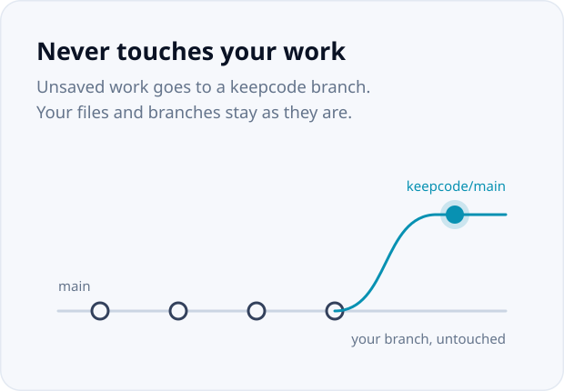</picture>
  <picture><source media="(prefers-color-scheme: dark)" srcset="docs/assets/feat-secrets-dark.svg">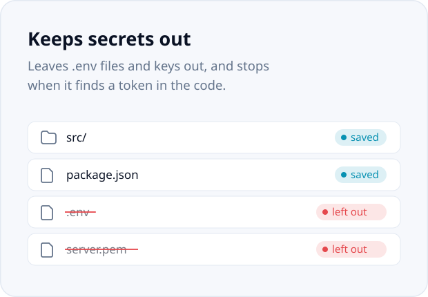</picture>
</p>
<p align="center">
  <picture><source media="(prefers-color-scheme: dark)" srcset="docs/assets/feat-daily-dark.svg">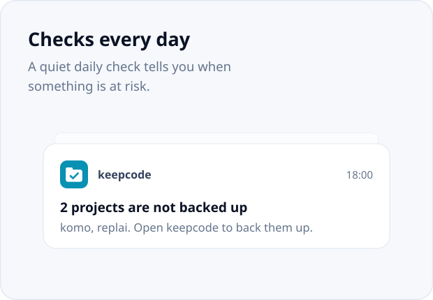</picture>
  <picture><source media="(prefers-color-scheme: dark)" srcset="docs/assets/feat-update-dark.svg">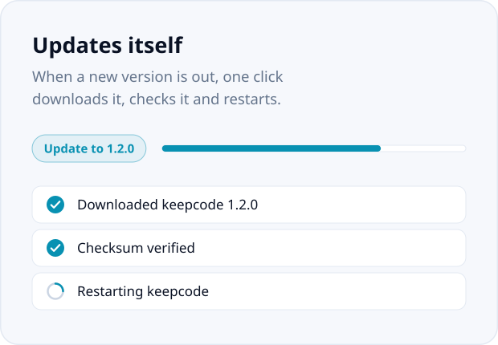</picture>
</p>

## Install

**Windows**: paste this in PowerShell. No Python and no administrator rights needed:

```powershell
irm https://raw.githubusercontent.com/masterrr3470/keepcode/main/install.ps1 | iex
```

It downloads the newest `keepcode.exe` from [Releases](https://github.com/masterrr3470/keepcode/releases), checks its SHA-256, adds keepcode to the desktop, the Start menu and your PATH, and opens the app. You can also download the `.exe` from Releases and double-click it.

**macOS and Linux**, or Windows with Python:

```bash
pipx install "keepcode[app] @ git+https://github.com/masterrr3470/keepcode"
keepcode app
```

keepcode needs [Git](https://git-scm.com/downloads). On Windows, if Git is missing, the app installs it for you with one click.

## First run

1. Open **keepcode** from the desktop or the Start menu.
2. Wait a few seconds while it searches your computer.
3. Check the list. Projects that look like copies of another folder, such as `app (1)`, are left unselected.
4. Click **Back up**. The first time, keepcode opens GitHub in your browser: type the short code it shows and click **Authorize**. No tokens to create or paste.
5. Each project goes to its own private repository, and the list shows what happened to each one.

At the end, keepcode offers to check your projects every day and tell you when something is at risk.

## What keepcode finds

<picture>
  <source media="(prefers-color-scheme: dark)" srcset="docs/assets/statuses-dark.svg">
  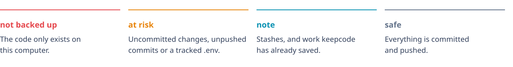
</picture>

keepcode searches your home folder seven levels deep and skips dependencies, build output, system folders and hidden folders. A monorepo counts as one project, and so does a FiveM server with all its resources (the files that come with FXServer are skipped). Folders that look like copies of each other, such as `app` and `app (1)`, are flagged so you back up the original only.

<details>
<summary><b>Which folders count as a project</b></summary>
<br>

A folder with a `.git` folder, or with a typical project file such as `package.json`, `pyproject.toml`, `requirements.txt`, `manage.py`, `Cargo.toml`, `go.mod`, `pom.xml`, `build.gradle`, `composer.json`, `Gemfile`, `pubspec.yaml`, `CMakeLists.txt`, `platformio.ini`, `project.godot`, `.sln`, `.csproj` or `.ino`. A Unity project, a FiveM server (a `server.cfg` next to `resources`) and an `index.html` next to its styles and scripts also count.

</details>

## How it works

<picture>
  <source media="(prefers-color-scheme: dark)" srcset="docs/assets/flow-dark.svg">
  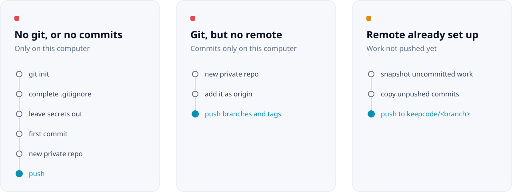
</picture>

keepcode always shows its plan and asks before changing anything, and `--dry-run` only shows the plan. On a remote you already use it never pushes your real branches, so nothing gets deployed by accident. Snapshots are built in a temporary staging area with `git commit-tree`, so your files, your staging area and your current branch stay exactly as they were.

To get a snapshot back:

```bash
git fetch origin
git switch -c recovered origin/keepcode/main
```

**keepcode never:**

* pushes to your existing branches on a remote you already use;
* force-pushes anything except its own `keepcode/*` branches;
* changes your files, except adding missing lines to `.gitignore` when it creates the first commit;
* writes your GitHub token to `.git/config` or the command line;
* runs your git hooks.

## In the terminal

Everything the app does is also a command, for scripts and for people who prefer to type. In a terminal, `keepcode` on its own walks through the same steps as the app.

| Command | What it does |
| --- | --- |
| `keepcode app` | Open the app window. Double-clicking `keepcode.exe` does the same. |
| `keepcode` | The guided mode: update, scan, back up and set up the daily check, step by step. |
| `keepcode scan` | List the projects at risk. `--all` also lists safe ones, `--json` prints JSON. |
| `keepcode backup` | Choose projects and back them up. Pass folders to skip the choice. `--dry-run` only shows the plan. |
| `keepcode check` | Scan and exit with code 1 when something is at risk. `--notify` shows a notification. |
| `keepcode login` | Connect to GitHub in the browser with a short code. `logout` disconnects. |
| `keepcode update` | Update to the newest version published on GitHub. |
| `keepcode schedule on` | Check every day. `--time 18:00` sets the time, `off` stops it. |
| `keepcode roots` | Choose the folders keepcode searches: `list`, `add`, `remove`, `reset`. |
| `keepcode ignore` | Choose folders keepcode skips: `list`, `add`, `remove`. |
| `keepcode config` | Change the search `--depth`, `--auto-backup` and `--auto-update` (`ask`, `auto` or `off`). |
| `keepcode doctor` | Check the version, Git, the app window, the GitHub connection, the folders and the schedule. |

<details>
<summary><b>Secrets</b></summary>
<br>

Before anything is committed or pushed, keepcode checks the files.

* `.env` files (but not `.env.example`), private keys, keystores and service account files are left out, and added to `.gitignore` when keepcode creates the repository.
* Tokens written in the code stop the backup. keepcode recognizes GitHub, GitLab, AWS, Google (including Gemini), OpenAI, Anthropic, Stripe, Slack, SendGrid, npm, PyPI, Telegram and Discord tokens, private keys, Supabase `service_role` keys, and FiveM license keys, `rcon_password` and Steam Web API keys in `server.cfg`. The public Supabase `anon` key is not reported.

When a secret is found, move it to a `.env` file or add `keepcode:allow` to the line if it is a false positive. The repositories are private, so you can also click **Back up anyway** in the app, or run `keepcode backup --allow-secrets`. Secret files are never backed up: keep them in a password manager.

</details>

<details>
<summary><b>Connecting to GitHub</b></summary>
<br>

keepcode only needs GitHub to create new repositories, and they are always private. The first time it needs one, the app (or `keepcode login` in a terminal) opens `github.com/login/device` in your browser and shows a short code, already copied to the clipboard. Type it, click **Authorize**, and keepcode keeps the login in Windows Credential Manager, macOS Keychain or Secret Service on Linux.

keepcode also uses, in this order, the `KEEPCODE_GITHUB_TOKEN`, `GITHUB_TOKEN` or `GH_TOKEN` environment variables and the [GitHub CLI](https://cli.github.com) if you are logged in there. `keepcode login --token` accepts a token you created yourself.

</details>

<details>
<summary><b>Updates</b></summary>
<br>

Every new version is built by GitHub Actions and published in [Releases](https://github.com/masterrr3470/keepcode/releases) with a `SHA256SUMS.txt`. When you open keepcode it checks for a newer release and shows an **Update** button. It downloads the new `.exe`, verifies the checksum, swaps the file and restarts keepcode. If the download does not match, it is discarded and nothing changes.

In the app, **Settings > Updates** chooses between asking, updating automatically and not checking. In a terminal, `keepcode config --auto-update auto` updates without asking, and `off` stops the check. Installed with pip or pipx, keepcode tells you the command that updates it instead.

</details>

<details>
<summary><b>Daily check</b></summary>
<br>

`keepcode schedule on` runs a check once a day and shows a notification when a project is at risk. On Windows it uses the Task Scheduler, needs no administrator rights and runs without opening a window. On macOS and Linux it uses your crontab.

The check only warns you. With `keepcode config --auto-backup` it also saves uncommitted and unpushed work to `keepcode/*` branches for projects that already have a remote. It never creates repositories on its own.

</details>

<details>
<summary><b>Limitations</b></summary>
<br>

* New repositories are created on GitHub only. Existing remotes on any host work for `keepcode/*` branches.
* The window uses Microsoft Edge WebView2, which comes with Windows 10 and 11. Where it is missing, keepcode opens in the terminal instead. On Linux the window also needs GTK or Qt (see the [pywebview docs](https://pywebview.flowrl.com/guide/installation.html)).
* Stashes are reported but not backed up.
* Files over 95 MB are left out, because GitHub rejects files over 100 MB. Git LFS is not handled.
* Hidden folders are not searched. Add them with `keepcode roots add`.
* On Linux, notifications from cron depend on your desktop session.
* `keepcode.exe` is not signed yet, so the first time you open a downloaded copy Windows may show "Windows protected your PC". Click **More info** and **Run anyway**. The install command does not trigger this.

</details>

<details>
<summary><b>Development</b></summary>
<br>

```bash
git clone https://github.com/masterrr3470/keepcode
cd keepcode
python -m venv .venv
source .venv/bin/activate        # Windows: .venv\Scripts\activate
pip install -e ".[dev]"
pytest
```

The tests create real repositories and local remotes in temporary folders, so they never touch GitHub. They run on Windows and Linux on every push, and GitHub Actions builds a test `keepcode.exe` you can download from the run.

The app is a [pywebview](https://pywebview.flowrl.com) window. `src/keepcode/app/web` holds the page (plain HTML, CSS and JavaScript, no build step) and `src/keepcode/app/api.py` the Python side it calls, which the tests cover without opening a window. Set `KEEPCODE_DEBUG=1` to open the browser developer tools inside it.

To build the executable on Windows: `pip install pyinstaller` and `python packaging/build.py`. It also opens the window once to check that it works. To publish a version, raise `__version__`, add it to `CHANGELOG.md` and run the **Release** workflow from the Actions tab (pushing a tag such as `v1.2.0` works too). It tests the code, builds the `.exe`, publishes it, and installed copies update themselves.

</details>

## About me

<picture>
  <source media="(prefers-color-scheme: dark)" srcset="docs/assets/author-dark.svg">
  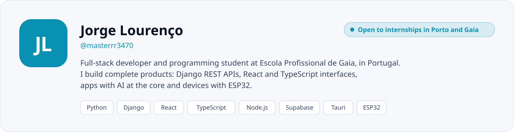
</picture>

I like building complete products, from the database to the last animation. Besides keepcode, I have built **Komo**, QR code ordering for restaurants; **PulseSync**, a heart monitor connected to an ESP32; **Replai**, AI replies to business emails; and **E-Materia**, a learning platform with AI. You can try them on my portfolio.

I'm open to an internship in Porto or Gaia, on site or hybrid. If keepcode saved one of your projects, I'd love to hear about it.

<p>
  <a href="https://jorge-lourenco.vercel.app/"><picture><source media="(prefers-color-scheme: dark)" srcset="docs/assets/btn-portfolio-dark.svg"></picture></a>
  <a href="https://github.com/masterrr3470"><picture><source media="(prefers-color-scheme: dark)" srcset="docs/assets/btn-github-dark.svg"></picture></a>
  <a href="mailto:lourencojorge428@gmail.com"><picture><source media="(prefers-color-scheme: dark)" srcset="docs/assets/btn-email-dark.svg"></picture></a>
</p>

<br>

<picture>
  <source media="(prefers-color-scheme: dark)" srcset="docs/assets/footer-dark.svg">
  
</picture>
